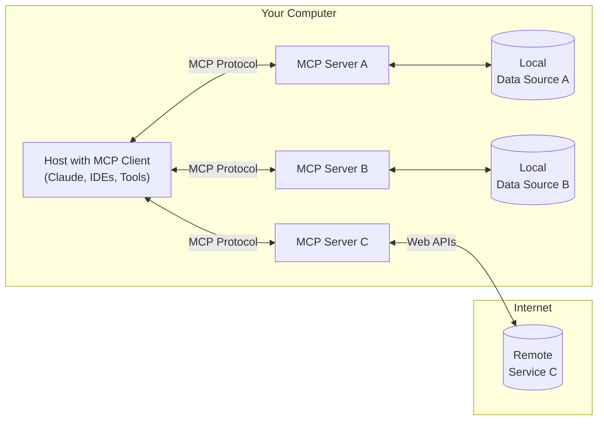
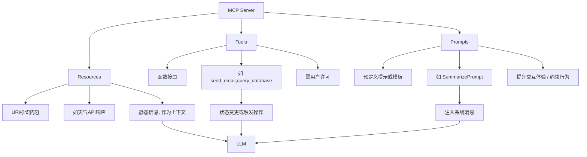
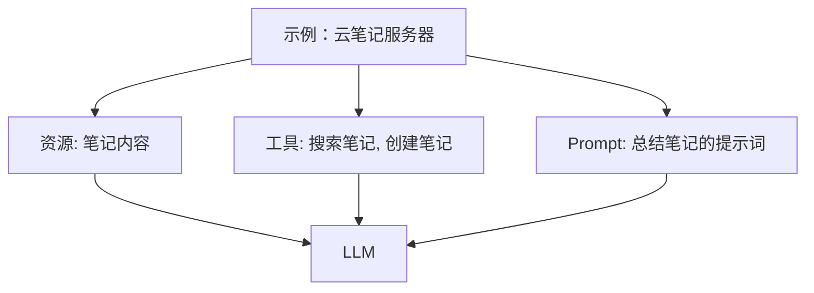
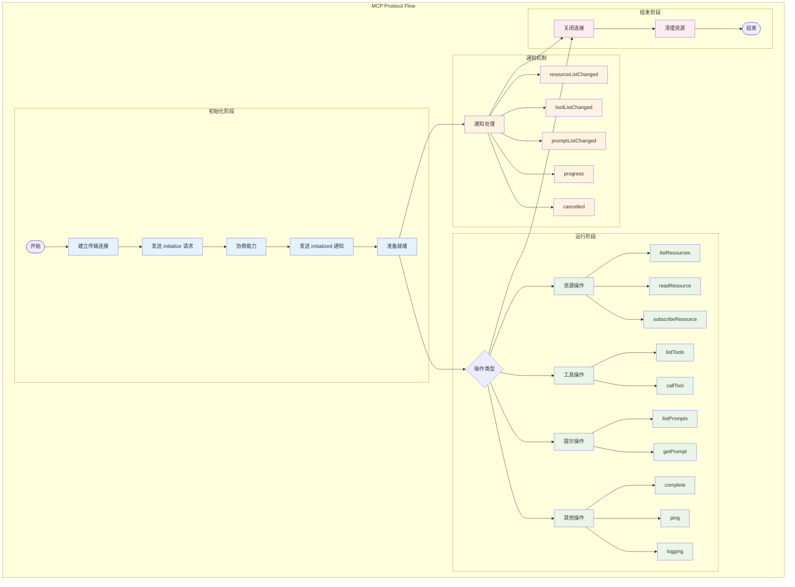
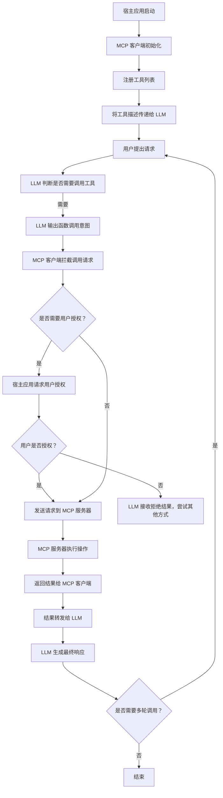
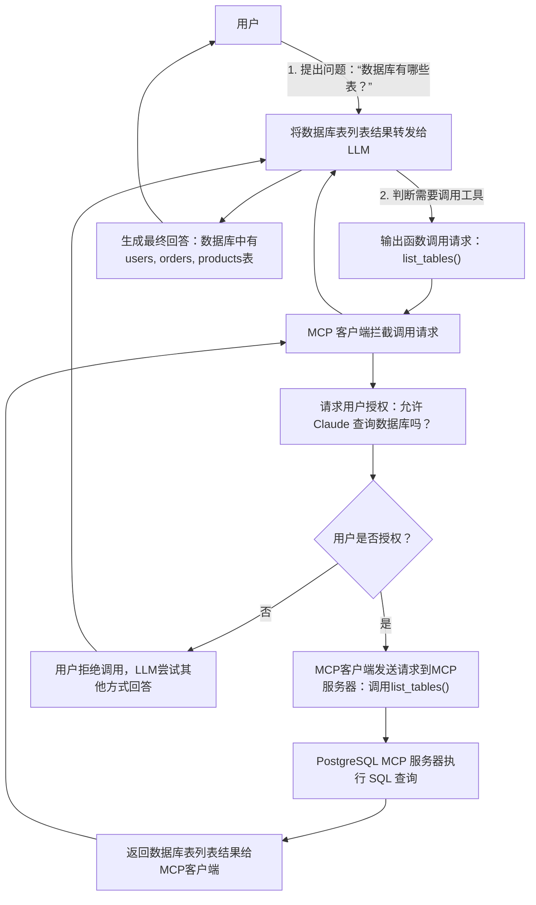
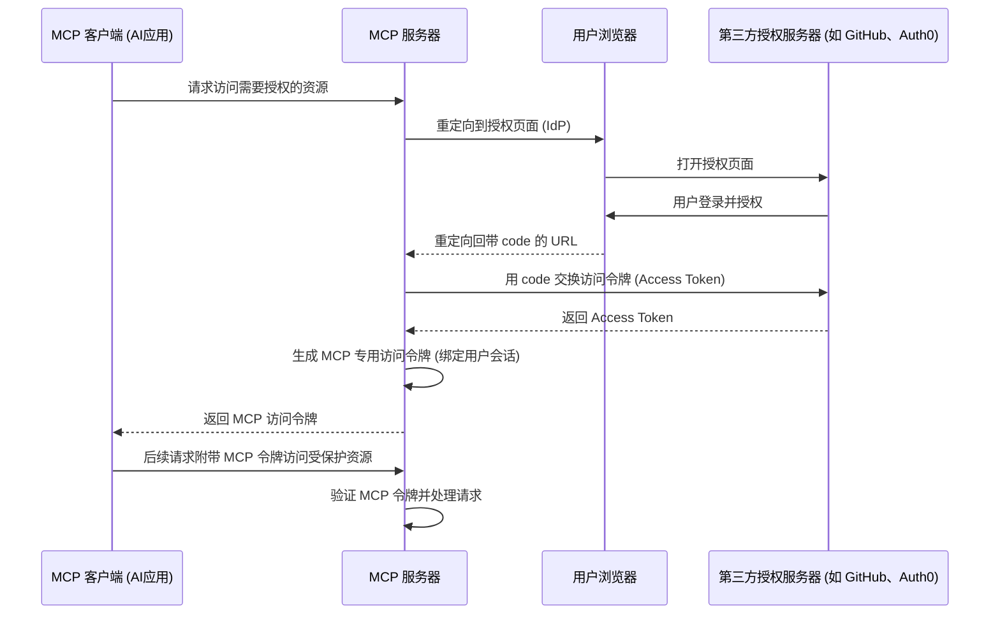

# 一篇文章看透  Model Context Protocol（MCP）

> 关于此分享，除了带大家全面的了解  MCP  的原理、构成、具体实现、安全、限制等通用内容，我们还将重点探讨一些关于认知的话题，例如  MCP  与  API  的区别，与  Function Calling  的区别等话题，最终通过这个分享，使大家：
>
> 彻底了解  MCP  的协议内容和实现，不管你之前对  mcp  有多少了解
>
> 认知对齐，以便更好做出决策
>
> 在此基础之上，大家才能继续探讨如何与公司的业务结合的深度问题。
>
> 听了这个分享之后，还有疑问优先看官方文档：
>
> - 官方文档：[Anthropic, *“Model Context Protocol  官方规范文档”*](https://modelcontextprotocol.io/specification/2025-03-26)
> - 测试项目：[https://github.com/small-tou/mcp-test](https://github.com/small-tou/mcp-test)
>
> MCP server  列表：
>
> - [https://github.com/punkpeye/awesome-mcp-servers](https://github.com/punkpeye/awesome-mcp-servers)
> - [https://github.com/yzfly/Awesome-MCP-ZH](https://github.com/yzfly/Awesome-MCP-ZH)
> - [https://cursor.directory/mcp](https://cursor.directory/mcp)

## MCP  的背景与意义

大型语言模型（LLM）如  ChatGPT、Claude  等在自然语言处理上非常强大，但过去它们与真实世界的数据和系统**隔离**。

开发者面临所谓的  “N×M  问题”：有  N  种模型、M  种工具，每种组合都需要定制整合。**模型上下文协议（Model Context Protocol, MCP）**  正是在此背景下由  Anthropic  于  2024  年提出的开放标准，旨在提供一个**通用方式**将  AI  应用连接外部数据源与工具。

通过  MCP，可以让  LLM **安全地访问本地和远程数据**，为  AI  应用提供统一的“万物接口”。这相当于为  AI  应用构建了**标准化的“通用接口”**：LLM  不必了解每个具体服务的  API，而是通过  MCP  统一使用工具/函数形式的接口来访问数据库、文件系统、Web  服务等。

MCP  的出现，有望打破  AI  应用中的数据孤岛，解决  LLM  隔离于实时信息和外部系统的难题。Anthropic  将  MCP  作为开源协议推出，各大厂商和社区也迅速加入支持，构建起丰富的  MCP  工具生态。

> 目前  MCP  已经成为了事实标准，包括  Anthropic  的竞争对手  OpenAI  也在客户端中集成了标准的  MCP  协议。
>
> MCP  可以获得成功我觉得有以下原因：
>
> - 协议内容非常简单和克制，使其不受制于任何场景，也很容易实现和集成，完美解决大模型和业务系统互通的最关键问题（资源、操作、提示词）。
> - 有非常成熟的  SDK  实现，包括各种语言，所以实现一个  MCP Server  或者  Client  其实就是几句代码的事情。
> - 有足够的关键机制保证，例如授权机制等。

## MCP  架构与核心组件

MCP  采用**客户-宿主-服务器**三层架构。在这个架构下，每个宿主应用（Host）可以运行多个客户端实例，与不同的服务器建立连接，从而集成多种  AI  能力，同时保持安全隔离。MCP  的核心组件包括：

- **MCP  主机（Host）**：指发起请求的  LLM  应用程序本身，例如  Claude Desktop  桌面应用、带  AI  助手的  IDE  开发环境或网页聊天界面等。Host  负责**容纳和协调**多个客户端实例，管理它们的权限和生命周期，并将 AI 能力嵌入现有应用中。Host  充当“容器”和“调度者”的角色，负责在不同工具/服务器之间**聚合上下文**并协调  LLM  的输出采样。
- **MCP  客户端（Client）**：集成在宿主应用内部的组件，用于处理与  MCP  服务器的具体连接。每个客户端与一个特定的服务器**一对一**连接，维护一个**有状态会话**。客户端负责协议**握手和功能协商**、在双向信道上传递请求和响应，并确保不同服务器间的上下文隔离。宿主可以创建多个客户端实例，每个连接一个不同的服务器，从而在同一个应用中并行使用多种工具。换言之，**每条 MCP 连接对应一个独立的工具/数据源**，由客户端负责通信和隔离。
- **MCP  服务器（Server）**：MCP  体系的服务提供方，通常围绕**特定功能或数据源**提供上下文和能力。每个服务器通过  MCP **暴露资源、工具和提示**等原语（primitives）供客户端调用。服务器各司其职，专注于某一类功能，例如一个  GitHub MCP  服务器专注于代码仓库操作，一个数据库  MCP  服务器专注于查询数据库。服务器可以是本地进程也可以是远程服务，但都必须遵守安全约束，只能看到必要的上下文信息，不能读取整个对话或“窥探”其他服务器的内容。这种**隔离和最小权限**设计确保了每个工具各自独立运行，彼此间由宿主受控交互。各服务器通过**JSON-RPC**标准接口向客户端提供功能，遵循统一的协议规范。

## MCP  原语

> LLM  可感知和调用的最基本功能单位，分为：
>
> - **资源原语（Resources）**：提供信息，通常静态、可读取，例如天气信息。
> - **工具原语（Tools）**：可调用执行操作的函数，例如发送邮件。
> - **提示原语（Prompts）**：注入到系统信息中引导模型行为的模板。

MCP  定义了**三类关键原语**供服务器提供功能：

- **资源（Resources）**：以  URI  标识的内容或数据，如文件内容、数据库查询结果、第三方 API 响应等，可供客户端读取或引用。资源一般是**静态信息**，大多在对话中作为上下文提供给  LLM。例如  “weather/today”  可能是一个天气 API 结果资源，LLM 可以请求读取它的内容。
- **工具（Tools）**：LLM  可主动调用的函数接口，用于执行动作或主动查询信息。工具调用往往会更改状态或触发操作，例如“`send_email(recipient, content)`”  或  “`query_database(sql)`”。由于其潜在影响，这些调用**必须经过用户许可**方可执行。工具为  LLM  打开了**操作世界**的大门，但也带来了安全隐患，需要严格管控。
- **提示（Prompts）**：预定义的提示或模板，用于指导  LLM  或与用户交互。比如某服务器可以提供一个  “SummarizePrompt”  工具，其实质是在  LLM  系统消息中注入一个总结模板以帮助  LLM  更好地完成特定任务。Prompts  本质上是**静态的文本**或指令片段，可以视作特殊类型的资源，用于**提升交互体验**或**约束  LLM  行为**。

通过组合以上原语，一个  MCP  服务器可以为  LLM  提供**丰富的上下文信息和操作能力**，增强模型的实用性和灵活性。例如一个云笔记的  MCP  服务器可以既提供“笔记内容”（资源），又提供“搜索笔记”“创建笔记”（工具），还提供一些“笔记总结模板”（prompt）。LLM  在交互中即可读取笔记内容，又能新增笔记或对笔记执行操作。正是这些灵活的原语设计，使  MCP  成为一个通用接口协议，可适配各种不同类型的服务和数据源。

## 资源/工具/提示词的生效机制

> Resources  和  Prompts  在社区有一些争议，目前有些工具只实现了   Tools  调用，例如  cursor。
>
> cursor  社区关于此的讨论：[https://forum.cursor.com/t/mcp-resources-not-working-in-0-46-9/59960/8](https://forum.cursor.com/t/mcp-resources-not-working-in-0-46-9/59960/8)
>
> 
>
> 

### Tools

MCP  中的工具被设计为**模型控制的**，这意味着语言模型可以根据其上下文理解和用户的提示自动发现和调用工具。

但是，实现可以自由地通过任何适合其需求的接口模式来公开工具——协议本身并不强制要求任何特定的用户交互模型。

> 为了信任和安全，**应该**始终人处于循环之中，并有能力拒绝工具调用。
>
> 应用程序**应该**：
>
> - 提供  UI，明确哪些工具正在向  AI  模型公开
> - 调用工具时插入清晰的视觉指示
> - 向用户提供操作确认提示，以确保有人参与

### Resources

MCP  中的资源被设计为**应用程序驱动**，主机应用程序根据其需求确定如何合并上下文。

例如，应用程序可以：

- 通过  UI  元素公开资源，以便在树或列表视图中明确选择
- 允许用户搜索和过滤可用资源
- 根据启发式方法（heuristics）或  AI  模型的选择实现自动上下文包含

### Prompts

提示被设计为由**用户控制**，这意味着它们从服务器暴露给客户端，目的是让用户能够明确地选择它们来使用。

通常，提示会通过用户界面中用户发起的命令触发，这使得用户能够自然地发现和调用可用的提示。

例如，作为斜线命令：

但是，实现者可以自由地通过任何适合其需求的界面模式来公开提示  -  协议本身并不要求任何特定的用户交互模型。

## 协议通信与消息流程

[《MCP TypeScript SDK  架构文档》](https://alidocs.dingtalk.com/i/nodes/oP0MALyR8k7YK1YNCEwYlGa083bzYmDO)

MCP  架构在传输层采用**JSON-RPC 2.0**协议格式，实现标准化的请求、响应与通知消息结构。支持两种主要传输模式：

- **STDIO  模式**：通过标准输入/输出流进行通信，常用于本地集成场景（服务器运行在客户端所在的本地环境）。例如，当用户在本地机器上安装了一个  PostgreSQL MCP  服务器时，Claude Desktop  可以通过启动该进程并与之  STDIO  通信。STDIO  方式实现简单、延时低，但要求服务器在用户本地运行。
- **HTTP + SSE  模式**：通过  HTTP  请求和服务器推送事件（Server-Sent Events, SSE）进行通信，适用于远程连接场景。客户端发送 HTTP 请求给远程  MCP 服务器，由服务器通过  SSE  流式返回响应数据。这使得  MCP  服务器可以部署在云端，服务多个客户端连接，支持更广泛的应用环境和用户设备（包括浏览器等）。SSE  支持结果的实时流式传输，保证与  LLM  流式输出兼容。

无论哪种传输方式，**所有  MCP  消息都采用  JSON-RPC  标准结构**。这意味着请求里包含方法名（对应工具/资源操作）、参数，响应里包含结果或错误码，从而保证客户端和服务器之间通信的一致性和可解析性。这样的设计类似于语言服务器协议（LSP）在开发工具中的作用：为 AI 应用提供统一、与底层工具无关的交互协议。

> mcp  不是开放平台，你会发现很多  mcp  实际上是跑在本地的一个命令，包括魔方的  mcp，但是也可以将  mcp  做成  http  服务的模式

## MCP  与  Function calling  的异同

MCP（模型上下文协议）和  Function Calling  是当前大型语言模型（LLM）与外部系统交互的两种主要机制。它们在设计理念、通信架构、适用场景和扩展能力等方面存在显著差异。理解这两者的关系和区别，有助于我们更好地构建和部署  AI  应用。

---

### 🧠  核心区别概览

| 特性     | Function Calling                         | MCP（模型上下文协议）                     |
| -------- | ---------------------------------------- | ----------------------------------------- |
| 定义者   | 各大模型厂商（如  OpenAI）               | Anthropic（开放标准）                     |
| 通信模式 | 模型输出结构化  JSON，由宿主应用解析执行 | 客户端通过  JSON-RPC  与  MCP  服务器通信 |
| 作用侧重 | 将自然语言转换为结构化函数调用           | 标准化函数调用的执行和上下文管理          |
| 状态管理 | 通常为无状态的单次调用                   | 支持状态化、多轮交互和上下文保持          |
| 扩展性   | 需为每个函数手动定义和集成               | 支持动态发现工具和资源，便于扩展          |
| 安全控制 | 由宿主应用自行实现权限控制               | 内置权限管理和能力协商机制                |
| 适用场景 | 简单、预定义的函数调用                   | 复杂、多步骤、需要上下文的任务            |

> 可以将  MCP  理解成  Function Calling  的高级版，Function Calling  是一个底层的机制，而  MCP  是一个高层的协议，Function Calling  依然需要开发者做很多事情，MCP  通过协议和 SDK 实现，直接大幅简化了开发工作量，双向减少工作量。

## MCP  与  API  的区别

### 定义与核心定位

| 特性           | MCP（模型上下文协议）                                       | 传统开放平台（如  GitHub API）                          |
| -------------- | ----------------------------------------------------------- | ------------------------------------------------------- |
| **设计目的**   | 为大型语言模型（LLM）提供统一的接口，连接外部工具和数据源   | 提供应用程序之间的数据交换和功能调用接口                |
| **主要用户**   | AI  模型、AI  应用开发者、AI  工具集成者                    | 前端/后端开发者、系统集成商                             |
| **通信协议**   | JSON-RPC 2.0，支持状态化、双向通信                          | 通常为  RESTful API，基于  HTTP，支持  GET/POST  等方法 |
| **上下文感知** | 是，支持动态上下文管理和多轮交互                            | 否，通常为无状态，每次请求独立处理                      |

### 架构与集成方式

| 特性           | MCP（模型上下文协议）                                          | 传统开放平台（如  GitHub API）                        |
| -------------- | -------------------------------------------------------------- | ----------------------------------------------------- |
| **集成方式**   | 通过  MCP  客户端与  MCP  服务器通信，支持动态发现和调用工具   | 通过固定的  API  端点进行调用，需要预先了解端点和参数 |
| **工具发现**   | 支持动态发现，LLM  可查询  MCP  服务器获取可用工具列表         | 不支持动态发现，需通过文档了解可用  API               |
| **扩展性**     | 高，支持在运行时添加新工具和资源，无需重启或重新部署           | 低，添加新功能通常需要修改代码并重新部署              |
| **标准化程度** | 高，提供统一的协议和数据格式，便于跨平台集成                   | 低，不同平台的  API  设计和数据格式可能差异较大       |

> 总的来说，MCP  是处理非结构化数据的接口协议，他的输入和输出（特别是输出）都是非结构化的，所以他不能直接处理类似于结构化数据精确查询和串联的工作流，所有数据都会经历  ->  非结构化输入  ->  结构化数据  ->  非结构化输入大模型  ->  非结构化输出  ->  下一个  mcp  调用的过程。而  API  调用是精确的调用，需要精确的逻辑来驱动流程。
>
> **不能简单粗暴把  MCP  理解成大模型时代的开放平台或者  api  集合，也不能把  Agent  理解成传统的工作流工具**

## 为什么大部分  MCP  都运行于用户的本地

> 现在绝大部分的  MCP server  都运行于用户的本地电脑，然后桥接到远程的传统服务中，例如  github、notion、figma  等等都是如此。其典型结构：
>
> 

> 这其实是理解  MCP  和  API  调用的一个关键点。
>
> 为什么  mcp client  和  mcp server  都要运行于用户的本地？关键原因是  client  和  server  之间无法维持用户认证的状态！
>
> 传统的  api  调用如何规避此问题的：
>
> - 第一种，用户电脑上使用，通过  cookie  或者类似的机制在电脑上记住  session  信息，并且会定时过期，用户通过交互可以随时切换用户。
> - 第二种，在服务端运行，通过  api token  来实现身份验证，通常不针对用户侧，而是服务之间的校验，并且因为不经过任何三方设备和网络，安全性可以得到保证。
>
> 对于  MCP  的架构来说，这两种规避方式都很难实现。通过将  MCP Server  部署在本地可以完全规避这个问题，客户端和服务器可以隐式地相互信任。
>
> 不过调用  MCP Client  的工具可以实现跟浏览器沙盒类似的机制来提供安全的远程  MCP  调用能力，不过因为  MCP  客户端五花八门，所以目前无法统一这些客户端的实现，没法达成跟浏览器一样的统一。
>
> 通过  [https://github.com/geelen/mcp-remote](https://github.com/geelen/mcp-remote)  可以将只支持本地调用的  Agent  客户端连接到远程  MCP Server  服务。
>
> 目前的   远程  mcp server，如果是采用直接配置  token  的方式来调用，这个非常危险的操作，因为这个 token 的存储环境和传输环境是非常复杂的，基本无法保证绝对的安全。如果采用  oauth  的方式，需要客户端支持沙箱环境，具体的安全性不好评估，完全看客户端的实现，整体来说，还是非常不安全。
>
> cloudflare  给出的一个  remote mcp  架构：
>
> 

> [https://blog.cloudflare.com/remote-model-context-protocol-servers-mcp/?utm_source=chatgpt.com/](https://blog.cloudflare.com/remote-model-context-protocol-servers-mcp/?utm_source=chatgpt.com/)

## 为什么大部分  MCP（模型上下文协议）服务器选择在用户本地运行

大多数  MCP（模型上下文协议）服务器选择在用户本地运行，主要出于以下几个关键考虑：

### 数据隐私与安全性

在本地运行  MCP  服务器可确保敏感数据（如本地文件、数据库、浏览器内容等）不被上传至云端，从而降低数据泄露风险。用户对数据的访问和处理具有完全控制权，符合“隐私优先”的设计理念。

### 低延迟与高性能

本地部署消除了网络传输延迟，使得  AI  模型与工具之间的交互更加迅速。这对于需要实时响应的应用场景（如本地文件搜索、代码编辑等）尤为重要。

## 连接建立与生命周期管理

当用户启动支持  MCP  的宿主应用（Host）时，应用会随即初始化  MCP  客户端并与配置的  MCP  服务器建立连接，完成**协议握手**和会话初始化。整个连接生命周期大致如下：

1.  **初始连接**：MCP  客户端在启动时，按配置启动或联系对应的  MCP  服务器。例如，在  Claude Desktop  的配置文件中添加  PostgreSQL MCP Server  的启动命令后，Claude Desktop  启动时会运行该服务器并尝试连接。客户端通过  STDIO  管道或  HTTP  对指定地址发起连接请求。如果服务器需要认证（如远程服务），此时可能要求先完成认证流程（详见后述安全部分）。
2.  **能力发现**：连接建立后，客户端会向服务器请求其**可用能力列表**，即询问“该服务器提供哪些工具、资源和提示？”。服务器随即返回一个描述其能力的列表，包括可调用的工具（函数）、可访问的资源（数据端点）、提供的预设提示模板等。每项能力通常以**名称、参数签名、功能描述**等元数据形式呈现。通过这个步骤，客户端“了解”了服务器能做什么。
3.  **注册与准备**：客户端收到能力清单后，会将这些能力**注册到宿主应用中**，以便后续会话中供  LLM  使用。注册过程意味着  Host  知道了这些工具/资源，并准备在对话中呈现给模型。此时会涉及到**能力声明与协商**：双方会确认各自支持的协议特性和扩展。例如，客户端和服务器在初始化时会交换各自**支持的功能集**（capabilities），确定是否启用如“采样控制”“通知订阅”等附加特性。MCP  设计允许**逐步协商**附加能力，确保向后兼容和灵活扩展。完成注册后，这条  MCP  连接就进入**就绪状态**，等待实际的调用。
4.  **会话管理**：在会话过程中，客户端与服务器维持**状态 ful**连接，能够多次往返消息。Host  负责跟踪整场对话的上下文，而服务器只看到被请求相关的片段信息。如果  Host  管理多个客户端会话，它需要聚合不同来源的上下文并避免串扰。例如，Host  可以选择只将对某服务器有用的那部分对话上下文发送给它，而不会泄露其他无关信息给服务器。这种机制确保**上下文隔离**和**最小信息披露**。当用户结束会话或关闭应用时，Host  会关闭各客户端与服务器的连接（本地进程则终止或远程 HTTP 断开）。整个生命周期中，Host  可能依据需要动态增删服务器连接、或在空闲时断开以节省资源，但需要确保断开前完成必要的清理和授权回收（例如撤销临时令牌）。

需要强调的是，**MCP  强调客户端/服务器解耦和易组合**。服务器侧实现应尽量简单，专注于自己的功能，而复杂的多服务器编排、上下文管理等由  Host  完成。这样一来，新服务器可以容易地加入而无需关心其他组件，从而形成高度可组合的  AI  工具生态。同时，每个服务器的独立性也提高了系统的健壮性，一处故障或漏洞不至于殃及整个 AI 应用。

## 工具与资源的调用机制详解

经过上述初始化阶段后，MCP  客户端已在宿主应用中注册了一系列外部工具和资源。接下来，当用户提出问题，LLM  如何判断并调用这些工具呢？整个**调用流程**如下：

1.  **工具呈现与提示**：宿主应用在对话开始时，通常会通过系统提示或函数接口将可用工具的描述告诉  LLM。例如  MCP  客户端会将服务器提供的工具列表作为函数列表，通过类似  OpenAI Function Calling  的接口发送给  LLM。这些描述包括工具名称、用途说明以及参数格式等。这样，LLM  对当前有哪些可用“能力”一清二楚。
2.  **LLM  需求识别**：当用户提出请求，LLM  首先根据自身训练知识和提示判断**是否需要借助工具**。如果用户问题涉及模型未知的实时信息或需要执行操作（如查询数据库），LLM  会意识到需要调用某个  MCP  工具。例如，用户问“数据库中有哪些表？”时，Claude  模型识别出这属于数据库查询，应使用  PostgreSQL  工具。相反，如果是普通常识问答，LLM  可能直接回答而不调用工具。这个**决策过程**完全由模型在推理过程中自主完成，基于之前提供的工具列表和使用示例。
3.  **函数格式输出意图**：一旦模型决定使用工具，它会以特定格式在回答中**输出一个函数调用**请求，而不是直接给出最终答案。对于支持函数调用的模型（如 GPT-4 函数调用模式或  Claude  的工具使用格式），它会输出预先约定的  JSON-RPC  请求或函数名加参数。例如，Claude  可能输出：“调用  `list_tables()`  函数”。这一步相当于 LLM 告诉客户端：“请帮我用某工具完成这部分任务”。
4.  **权限校验与用户授权**：MCP  客户端拦截到  LLM  的函数调用意图后，并不会立刻执行，而是先检查**该操作是否需要用户许可**。大多数涉及外部系统的操作默认需要用户授权以确保安全。此时客户端会在界面弹出**权限请求**提示，告知用户模型想访问哪个工具或资源，并说明可能的影响。例如：“Claude  想查询  PostgreSQL  数据库中的表结构，是否允许？”。这是  MCP  非常重要的安全机制  —— **“人圈”（Human-in-the-loop）**。只有在用户明确点击允许（Allow）后，请求才会继续。用户也可以拒绝，此时 LLM 将收到一个拒绝结果，只能尝试用其他方式回答或告知无法获取权限。
5.  **请求发送与执行**：一旦用户授权，MCP  客户端按照既定协议格式，将 LLM 的请求发送到相应的  MCP  服务器上。请求内容包括要调用的工具名称和参数（例如函数名和参数值），MCP 服务器接收后执行对应操作。举例来说，对于数据库查询函数，服务器将连接数据库运行 SQL；对于 GitHub 操作，服务器会调用 GitHub API  执行提交代码等动作。MCP  服务器在执行过程中可以访问其**托管的资源**（本地或远程），但只能在其权限范围内进行操作（例如  PostgreSQL MCP 服务器被设计为只读查询，不允许写操作）。执行完成后，服务器将结果打包成统一格式的响应返回给客户端。这个响应可能包括查询得到的数据、操作的结果确认，或错误信息（如果执行失败）。
6.  **结果返回与整合**：MCP  客户端收到服务器返回的结果后，会将其转发给  LLM，同时也可能将结果暂存于宿主的**上下文**中。LLM  获取到外部信息后，会将其纳入自身对话状态，使之成为后续回答的一部分。比如，上例中数据库表列表返回后，Claude  就“知道”了有哪些表，可以据此生成回答。由于 LLM 上下文窗口有限，客户端有时会对结果做一定预处理（例如截断过长文本或转换格式）再提供给模型，以确保不会超出模型处理能力。但理想情况下，这些步骤发生在数秒内，对用户是无感知的。
7.  **LLM  响应生成**：LLM  将外部工具返回的信息融合进其对话上下文，随后基于用户最初问题生成自然语言回答。这个回答已经包含了通过工具获取的最新数据或操作结果。对于用户而言，LLM  就好像突然“知道”了训练数据之外的信息一样，实际上是通过  MCP  在幕后实时获取的。整个过程对用户来说非常**顺畅**：除了在第一次使用某工具时点了授权，之后与 AI 对话并没有太大区别。
8.  **多轮调用与上下文维护**：如果用户的请求需要多步工具调用（例如先后调用多个 API 获得不同信息），LLM  可能重复上述决策过程，多次请求不同工具，然后综合结果再回答。MCP  协议允许**并行多个客户端**满足这种复杂场景，但每次工具调用仍需用户授权确认（除非用户设定了持久信任策略）。Host  负责将多次调用的上下文串联起来，保证 LLM 始终记住之前获取的外部信息。同时每个工具调用的结果也可以作为**中间上下文**缓存下来，避免重复请求相同数据。

## 安全与权限模型

在开放 LLM 对外部工具的访问时，安全绝对是不容忽视的方面。MCP  从**传输层**和**应用层**两方面提供了完整的授权与安全机制，确保**用户授权、权限隔离和数据安全**。

### 用户许可与权限边界

> 服务端授权机制，例如魔方的机制：[《Personal Access Token  相关  Java  类文档》](https://alidocs.dingtalk.com/i/nodes/N7dx2rn0JbZzB1zoC5Yno0gzJMGjLRb3)，这个是实现  mcp  调用的最大的前提机制。

> 双向的授权策略管控：
>
> - 服务侧管控，生成 token 的时候，只提供有限权限（平台通常提供配置能力），
> - 客户端管控，由每个客户端自己实现，大部分客户端可能需要用户自己确认每一个  mcp  调用，但是也可以设置成自动执行（例如  cursor），但是客户端也会有更深度的策略，例如删除文件的操作必须用户确认等，这完全是客户端和大模型决定的

首先，MCP  强制要求**用户明确授权**每一个工具或资源的访问。这体现为每当  LLM  尝试首次使用某项 MCP 能力时，客户端都会弹出提示征求用户许可。例如，在  Claude Desktop  中，当模型想读取本地文件或查询数据库，界面会显示“允许  Claude  访问 XX 工具/数据吗？”的对话框。只有用户点击允许（Allow），请求才会发送；若用户拒绝，LLM 则无法获取该数据。这样设计将人类用户始终保持在回路中，有效防范了**自动化滥用**和**潜在误用**。同时，MCP  工具描述中往往会注明其性质和可能影响，帮助用户做出判断。但需注意，这些注解仅供参考，不能作为安全决策的唯一依据，因为工具元数据可能不可靠。因此，**清晰的权限提示**和**用户教育**非常关键。

其次，MCP  服务器本身也通过**限制权限**来保障安全。每个服务器通常只提供有限的操作范围，例如  PostgreSQL  参考服务器被设计为**只读**，不提供修改数据库的功能。又如  Notion MCP  服务器可以使用**集成令牌**配置成仅读取或读写特定页面。通过在服务器端限制功能边界，即使 LLM 被误导滥用了工具，造成的影响也在可控范围内。**最小权限原则**在  MCP  中得到了贯彻：为  LLM  开启外部权限时，尽可能授予**足够但不过度**的能力。

更进一步，宿主应用可以实现**细粒度的权限管理和会话隔离**。Host  掌控所有客户端与服务器的连接，因此可以在应用层增加访问控制策略。例如，可设定某些服务器需要用户每次使用都确认，或某些敏感操作需加强校验。Host  也可以在多轮对话中维持**会话态的权限**，比如用户同意了当次查询，在上下文没变的情况下再次查询可能不重复提示。总之，**以用户意愿为中心**的权限模型贯穿  MCP  的设计，尽量避免在引入强大外部能力的同时失去对 AI 行为的可控性。

### OAuth2.1  安全协议交互

对于需要访问**在线账户或敏感数据**的  MCP  服务器，仅有用户当场点击允许还不够，还必须有完善的**身份认证和授权**机制。在 2025 年 3 月更新的  MCP  规范中，引入了对  **OAuth 2.1**  授权流程的支持，以标准化  MCP  客户端与服务器的授权交互。OAuth 2.1  是业界广泛采用的授权框架，允许第三方应用经用户许可代表用户访问受保护资源。MCP  将其引入，提供了**API 密钥**和**OAuth Code**等多种模式，使  LLM  在访问诸如  Google、GitHub  这类已有 OAuth 体系的服务时能够遵循安全最佳实践。

典型的  OAuth  授权流包含如下步骤：

1.  **客户端发起  OAuth  流程**：当  MCP  客户端发现服务器需要用户登录授权（例如访问用户的云端数据），它会向  MCP  服务器发起标准的  OAuth  授权请求。这通常涉及打开用户浏览器，跳转到授权页面。
2.  **重定向至身份提供商**：MCP  服务器接到请求后，会将用户代理（浏览器）重定向到对应服务的**第三方授权服务器**（通常是该服务的登录页面）。例如  Slack MCP  服务器会把用户引导到  Slack  的 OAuth 同意页面，GitHub MCP  则指向 GitHub 的 OAuth 页面。
3.  **用户登录并授权**：用户在第三方授权页面上登录（如果尚未登录）并同意授予  MCP  应用相应权限（如读取其数据）的授权。这一过程和用户平常授权手机 App 访问自己 Google 账户类似，用户清楚是把权限赋予哪个服务。
4.  **携带授权码回跳**：第三方授权服务器在用户同意后，会携带一个\*\*授权码（code）\*\*将用户浏览器重定向回预先登记的  MCP  服务器回调地址。此时用户浏览器 URL 会包含 code，MCP 服务器获取此 code 以继续流程。
5.  **交换令牌**：MCP  服务器拿到授权码后，在后端向第三方授权服务器发送请求，用授权码换取**访问令牌（Access Token）**。例如用  Slack  授权码去 Slack 获取一个访问令牌。此令牌代表 MCP 服务器经用户同意可调用第三方 API 的凭证。
6.  **签发 MCP 令牌**：MCP 服务器拿到第三方的访问令牌后，通常不会直接把它暴露给客户端，而是在内部生成一个**MCP 专用访问令牌**，绑定用户的第三方会话。可以理解为服务器自己当起了一个资源服务和简易授权服务，借助第三方 OAuth 结果建立起一份**受控的会话凭证**。
7.  **客户端完成授权**：最后，MCP  服务器将上述 MCP 访问令牌通过之前的连接传递给  MCP  客户端，标志授权流程完成。客户端此后每次调用服务器上的工具都会带上这个 MCP 令牌，以证明它已获授权。服务器据此校验并决定是否允许请求执行。

通过以上  OAuth  流程，MCP  能无缝对接现有的身份认证基础设施。值得注意的是，MCP  规范**强制**实现若干安全措施：

- 包括对所有客户端应用强制启用  PKCE  校验、防范授权码拦截；
- 要求支持  OAuth2 **授权服务器元数据发现**机制，方便客户端自动获取授权端点、令牌端点等信息，减少手动配置出错；
- 鼓励支持  **动态客户端注册（DCR）**，允许客户端应用自动将自己注册到 MCP 服务器的授权服务器中。

这些措施大大提升了集成  OAuth  的便利性和安全性，使  MCP  在实际企业环境中更易落地。

然而，目前  MCP  对  OAuth2.1  的支持仍在演进中，也存在一些局限。在当前规范下，MCP  服务器同时扮演了**资源服务器**和**授权服务器**的角色，即既要验证和管理访问令牌，又要提供受保护的数据和功能。这违反了  OAuth  通常的“**授权服务器**”与“**资源服务器**”分离原则，带来了实现和运维上的复杂度。例如，MCP  服务器需要存储状态（会话、刷新令牌等）来管理认证，这使它不再是无状态服务，难以水平扩展。理想情况下，企业更希望利用已有的  IdP（身份提供商）作为授权服务器，而让  MCP  服务器只专注当资源服务器，验证来自  IdP  的令牌即可。目前社区也在讨论改进授权架构，将来或许会调整规范，允许更灵活的第三方授权集成。在此之前，MCP  实现者需要仔细遵循规范，正确实施各 OAuth 端点和令牌管理，避免安全漏洞。总的来说，引入  OAuth 2.1  为  MCP  增添了企业级安全保障，但也对服务器开发者提出了更高要求，需要权衡安全、复杂度和可扩展性。

> 核心问题：
>
> - 资源和授权由同一个服务提供，此服务是有状态服务，不利于水平扩展。
> - 客户端存储  token  的方式实现各不相同，没有沙箱机制，可能会有安全问题。

### 其他安全问题

#### 恶意攻击

除了权限授权，MCP  在设计上还考虑了**提示注入**等 LLM 常见安全问题。例如，MCP  工具的元数据（描述、注解）虽然会提供给  LLM  参考，但规范中特别警告**不要依赖这些信息做安全决策**，因为恶意服务器可能提供虚假描述试图诱导  LLM。宿主应用应对第三方 MCP 服务器保持警惕，避免将工具描述直接作为系统提示的重要部分，必要时可对其做审核。

又比如\*\*“地毯拉撤”攻击\*\*（rug pull attack）：MCP  允许服务器动态更改工具列表和描述，即使用户最初同意了某工具，服务器后续可能换掉实现或更改描述。

这提示客户端开发者在 UI 上要清晰展示工具来源，并在每次会话或重要变化时重新提示用户确认，而不能一劳永逸信任首次同意。总体来说，引入外部工具固然提升了 AI 能力，但也打开了新的攻击面，需要在协议和实现层层把关，从用户授权、协议规范、安全审计等多方面构筑**纵深防御**，确保  AI  应用在强大的同时也可靠安全。

#### 本地恶意脚本

规范支持[通过  stdio  运行  MCP“服务器”，](https://modelcontextprotocol.io/docs/concepts/transports#standard-input-output-stdio)从而可以无缝使用本地服务器，而无需在任何地方实际运行  HTTP  服务器。这意味着许多集成会指示用户下载并运行代码才能使用它们。显然，通过下载和运行第三方代码遭到黑客攻击并非新漏洞，但该协议实际上为技术水平较低的用户在本地计算机上利用漏洞创建了一条低成本的途径。

#### MCP  没有针对工具风险级别的概念或控制。

用户可能正在使用各种与  MCP  连接的工具与助手聊天，包括：read_daily_journal(…)、book_flights(…)、delete_files(…)。虽然他们选择的集成方式可以节省不少时间，但这种程度的代理自主性却相当危险。有些工具无害，有些工具成本高昂，还有一些工具则完全不可逆——代理或应用程序本身可能并未考虑到这一点。尽管  MCP  规范建议应用程序实现确认操作，但很容易理解，当大多数工具都无害时，用户为何会陷入自动确认模式（或“ [YOLO  模式](https://forum.cursor.com/t/yolo-mode-is-amazing/36262)”）。接下来，你可能不小心删除了所有度假照片，而代理却好心地决定为你重新预订行程。

[https://modelcontextprotocol.io/specification/draft/basic/security_best_practices](https://modelcontextprotocol.io/specification/draft/basic/security_best_practices)

## 挑战与局限

尽管  Model Context Protocol  为  LLM  接入外部世界提供了统一途径，但当前技术实现上仍存在一些**挑战和局限**，需要我们理性看待：

- **总结下前面提到的安全问题**

  - 可以动态刷新  server tools  的列表和定义、描述
  - 可以引导  agent  获取敏感信息并传入  tools  实现攻击
  - 授权方式可能导致  token  泄露等问题
  - 本地脚本可能引入不安全的木马程序
  - 传统的  api  设计需要程序驱动，所以在数据隔离上考虑不一定全面，但是 agent 可以打破这个限制，任何人都可以随意组合数据  [案例](https://blog.sshh.io/i/161242947/mcp-can-break-traditional-mental-models-for-data-access-control)

- **无法有效自动注入业务知识**

  - 例如一个创建卡片的  tool，其中的参数具备较为复杂的规则，在不具备业务知识的前提下，无法有效调用此  api

- **云原生支持的缺陷**：

  - MCP  在早期主要支持本地  STDIO  方式，这意味着用户必须在本机安装各种  MCP  服务器（Docker  容器或本地程序）才能使用，门槛较高。普通用户可能没有开发环境来跑这些工具，并且本地运行的服务器需要手动更新、维护，缺乏云端的弹性。此外浏览器等 Web 应用一开始无法直接使用  MCP，因为无法在用户浏览器中启动本地服务。
  - 这些限制让  MCP  的早期用户多为开发者。
  - 虽然最新规范引入了  HTTP+SSE  远程传输，Cloudflare  等厂商也推出了**远程  MCP Server  托管**服务，使得服务器可部署在云端供任意客户端访问。但是在广泛实现真正的云原生之前，MCP  生态还需要解决多租户、安全隔离、服务器发现等一系列问题。
  - 目前看来，从“每个用户本地跑插件”过渡到“集中云服务提供工具”，是  MCP  发展的必然趋势，也是在座各位产品和架构负责人需要关注的方向

#### MCP  没有成本概念或控制。

- 传统协议并不太在意数据包的大小。当然，你会希望你的应用支持移动数据，但几 MB 的数据量也没什么大不了的。然而，在 LLM 领域，带宽成本高昂，1MB 的输出数据，每个包含该数据的请求大约需要 1 美元（这意味着你不仅需要支付一次费用，而且在每条包含该工具结果的后续消息中都需要支付）。代理开发者（参见[Cursor 投诉](https://www.reddit.com/r/ClaudeAI/comments/1jm4zo4/is_anyone_else_getting_overcharged_on_cursorai_i/)）开始感受到这方面的压力，因为现在用户的服务成本可能很大程度上取决于 MCP 集成及其令牌效率。例如我们搜索表的接口，返回了大量无用信息，搜索一次表整个 token 就被占满了
- **系统可以同时存在的  MCP  是非常有限的**

  - 大量的  mcp ，可能会明显降低  Agent  的准确性，所以通常可以使用的  mcp server tools  不能过多，而且随着  tools  增加准确性会逐步降低。

- **部分类型问题无法有效解答**

  - 假设一位非技术用户想要通过  MCP  服务器将  ChatGPT  连接到他们的  Google Drive。MCP  提供了以下标准工具：

- `list_files(...)`–  显示所有文件
- `read_file(...)`–  打开/读取文件内容
- `delete_file(...)`，`share_file(...)`， ETC。

- 乍一看，这似乎足以让 AI 访问并推理用户的文档。现在，用户会问：*“我在自己写的文档中提到过多少次‘AI’？”*听起来很简单，对吧？只需阅读文档并数一数即可。但实际情况是这样的：

- 助手用来`list_files(...)`获取所有文档。
- 然后它会进行多次`read_file(...)`调用  — —  每个文档一次。
- 在约  30  份文档之后，它达到了**上下文窗口限制**（LLM  无法容纳更多文本）。
- 它放弃并返回部分结果，例如：_“您说了  14  次‘AI’”_（但只搜索了  30  个文档  -  而用户有数百个）。

- **会话状态管理问题**：

  - MCP  协议本身提供了状态管理（有状态会话、连续对话）的机制，但在某些方面仍有不足。
  - 其一是**授权会话状态**：如前所述，当前  MCP  规范让服务器兼任授权服务器，必须保存用户的认证状态（令牌、会话），这破坏了服务器的无状态特性，给水平扩展带来挑战。服务器需要维护有效令牌列表、处理刷新和失效，这对原本可以做无状态扩展的系统而言是负担。企业如果要将  MCP  引入微服务架构，可能倾向修改架构以让授权状态由专门的 IdP 管理。
  - 其二是**上下文状态一致性**：Host  保留了完整对话，但各  Server  仅知部分信息，这种隔离提高安全但也增加了  Host  统筹难度。Host  必须管理各  Server  提供信息在对话中的生命周期，防止因上下文不一致导致 AI 回答错误或工具误用。例如，一个 Server 提供的临时数据在稍后可能过期或被另一个 Server 更新，Host 需要决定何时让 LLM 刷新该信息。当前  MCP  规范并未规定具体的会话状态同步策略，这就留给实现者自己权衡取舍：在安全隔离和跨工具协同之间找到平衡。

- **缓存与一致性难题**：

  - 为了减轻上述上下文限制，开发者通常会引入**缓存机制**，比如缓存最近用过的工具结果、对大型数据集先构建向量索引或摘要，供 LLM 查询而不每次都读完整数据。然而缓存带来了新的挑战：**数据一致性**和**过期策略**。
  - 例如 AI 助手第一次查某文件内容后缓存了摘要，如果文件稍后经其他途径更新了，AI  再回答时仍引用旧摘要就会产生错误认知。同样地，如果 AI 缓存了数据库查询结果，后续数据库中的数据变动将不会反映在 AI 的回答中。这对实时数据源尤为不利。
  - 一方面，我们希望通过缓存和预处理提高效率、降低 LLM 调用次数；另一方面，又必须确保缓存的数据与真实数据保持一致或及时失效。这需要在系统架构中增加**失效策略**：比如为每个工具结果设置有效期，或由服务器提供变更通知（MCP  协议支持通知机制）让客户端清除过期缓存。
  - 另外，如果 AI 在对话中反复用到同一信息，Host  可以考虑在对话上下文中保留摘要而非原文，使模型在窗口内“记住”这些内容，从而减少重复工具调用。但这也要求摘要足够准确可靠，否则 AI 记住的是错误信息反而更麻烦。
  - 可见，**缓存是一把双刃剑**：用得好能提升性能和效果，用不好会引入一致性问题。目前  MCP  并没有提供现成的缓存一致性方案，这部分需要开发者根据应用特点自行权衡实现。在严肃场景下，宁可牺牲一点性能也要保证每次从源头获取新鲜数据；在对性能要求高的场景，则要设计层层校验，尽量减小缓存过期带来的影响。

- **工具编排与复杂推理**：

  - MCP  提供了工具调用的标准接口，但如何让  LLM **聪明地编排多个工具**去完成复杂任务，目前仍然是难点。
  - LLM  往往缺乏规划长链任务的能力，如果用户的需求需要调用不同类型工具协作完成，模型可能无从下手或效率低下。例如前述需要在 Google Drive 读取表格再去 LinkedIn 查询信息再交叉比对的例子，就是对 AI 规划能力的巨大挑战。
  - 当前  MCP  框架下，这种多工具协同主要依赖**人类提供明确的中间步骤提示**或者**预先设计好的 Agent 策略**。如何让 AI 自主分解问题并调用多个 MCP 工具仍属前沿研究领域。
  - 如果没有良好的工具编排，MCP  提供再多接口，AI  也难以发挥全部潜力。
  - 因此在实际应用中，我们常需要结合**任务特定的脚本**或**Agent 调度器**（如 LangChain 之类的框架）来配合  MCP，一方面管控 LLM 调用工具的顺序，另一方面在中间步骤对 LLM 输出进行监督和引导。
  - 这超出了 MCP 规范的范畴，但却是影响整个平台实际效果的关键因素。

## MCP  应用实例：数据库、代码仓库与笔记整合

自  MCP  推出以来，社区和厂商已经开发了众多**MCP  服务器插件**，覆盖数据库、文件、办公应用、开发工具等领域。这些服务器丰富了  LLM  可以访问的外部能力。下面以  PostgreSQL、GitHub  和  Notion  为例，说明  MCP  如何将  LLM  与具体系统集成，以及这些工具在实际产品中的用例。

### 示例一：连接  PostgreSQL  数据库

[https://cursor.directory/mcp/postgresql](https://cursor.directory/mcp/postgresql)

> 一个典型的流程是：
>
> - 用户提问
>
> - mcp  调用列出所有的表信息，包括字段信息
>
> - agent  判断用户问题和这些  schema  之间的可能用到的表的列表
>
> - 生成  sql
>
> - mcp  调用执行  sql
>
> - 总结执行返回的信息

PostgreSQL MCP Server  是  MCP  官方提供的参考实现之一，用于演示  LLM  如何查询结构化数据库。该服务器允许  AI  助手通过自然语言执行  SQL  查询，并获取结果。目前的设计限定为**只读查询**，即只允许 SELECT 等读取操作，不支持 INSERT/UPDATE 等修改，以确保安全。这一限制展示了  MCP  工具如何**通过限制功能来降低风险**。

**使用场景**：产品或运营团队可以通过  AI  助手查询内部数据库。例如，用户直接问：“本月销量最高的产品是什么？”  助手会将请求转换为 SQL 查询（如  `SELECT ... ORDER BY sales DESC LIMIT 1`），通过  PostgreSQL MCP Server  在数据库中执行，然后将结果用自然语言回答给用户。这使没有 SQL 技能的人也能获取数据洞见，提高了数据分析的便利性。

**工作流程**：以  Claude Desktop  集成  PostgreSQL  为例，用户在  Claude Desktop  配置文件中加入  PostgreSQL MCP Server  的启动命令和数据库连接串，然后重启应用。Claude Desktop  会自动启动该  MCP Server  并建立连接。在对话中，当用户提出与数据库相关的问题时，Claude  模型识别出需要用数据库工具，客户端随即弹出授权请求，确认用户允许访问数据库。用户点击允许后，Claude  先调用  Postgres  工具获取数据库结构信息（如有哪些表、字段），然后执行对应的查询。整个查询和结果返回通过  MCP  完成，Claude  最终将结果（比如产品名称和销量）告诉用户，并指出这是基于实时数据库查询。在  InfoQ  的演示中，Claude  能够成功通过  PostgreSQL MCP Server  获取数据库表列表并回答用户的问题，界面上还提供了一个“查看查询结果”的选项，让用户可以核对  SQL  查询和结果，验证  AI  的回答。这一例子展示了  MCP  如何无缝增强  LLM  的数据访问能力：AI  不再局限于训练语料，而是能够**实时查询业务数据库**来回答问题，而且查询过程透明、可审核。

### 示例二：集成  GitHub  代码仓库

[https://github.com/github/github-mcp-server](https://github.com/github/github-mcp-server)

> 一个典型的高频场景，运行于本地的  mcp  服务，可以结合本地的  git  仓库来理解整个项目和进行远程交互，例如获取  pr，review 代码，合并 pr 等

GitHub MCP Server  是社区广泛关注的另一个集成，它让  AI  助手能够与  GitHub  仓库和开发工作流交互。GitHub MCP  最初版本功能有限，但经过迭代，目前已经支持**多种仓库操作**，成为  AI  助手对接外部 API 的标杆案例。

**可用能力**：GitHub MCP  服务器提供了丰富的工具接口，包括：自动执行仓库操作（例如推送代码、合并  Pull Request）、提取或分析仓库数据（如读取文件、统计代码行数）、甚至触发 GitHub Actions 去构建部署等。这些能力意味着  LLM  可以帮助开发者完成从代码变更到项目管理的一系列任务。例如，AI  助手可以根据聊天指令在 GitHub 上创建一个新仓库、提交模板代码，或查找某个项目中的特定函数定义。

**使用场景**：面向开发团队，AI  编程助手利用  GitHub MCP  可以直接读取仓库代码内容，回答关于代码实现的问题，或根据用户要求修改代码并提交。这使  AI  真正成为开发工作流的一部分，而不仅仅是在 IDE 中给建议。例如，产品经理说：“请在我们的 repo 中新建一个 README 并添加项目简介”，AI  助手可以使用 GitHub MCP 创建文件并提交。又或者开发者询问：“我们项目里有没有用到 MD5 算法？”，助手可以检索仓库代码并返回包含 MD5 的文件列表。更高级的，结合  CI/CD，AI  助手甚至能自动在测试通过后合并拉取请求、部署应用，从而实现场景化的**DevOps  自动化**。

**安全授权**：由于涉及用户的  GitHub  账户，GitHub MCP Server  通常需要通过  OAuth  登录用户的  GitHub 账号获取访问令牌（这就用到了前述 OAuth 流程）。用户需在首次连接时通过浏览器授权  AI  应用。之后 AI 的操作都以该用户身份进行，权限不超出用户本身的权限范围。用户也可以为 AI 创建一个**机器人账户**或限定权限的令牌，确保 AI 只能访问特定仓库或只能有只读权限等。通过这种方式，可以控制  AI  在  GitHub  上的操作边界，防止越权行为。

GitHub MCP  的实践证明，AI  与软件开发平台结合有巨大潜力。AI  开始能够**读写代码**、**管理项目**，从辅助写代码演进为辅助完成代码生命周期的各个环节。当然，在生产环境使用时，需要结合代码审查机制，确保  AI  提交的更改经过人类验证。同时每次关键操作（如推代码到主分支）都应让用户确认。总体而言，GitHub MCP  让  AI  真正参与到协同开发，大幅提高开发效率和自动化程度。

### 示例三：融合  Notion  笔记内容

[https://developers.notion.com/docs/mcp](https://developers.notion.com/docs/mcp)

Notion MCP Server  则面向办公和知识管理场景，连接  AI  与流行的笔记/文档应用  Notion。Notion  官方维护了该  MCP  服务器的开源实现，方便用户将  AI  助手接入自己的  Notion  工作区。通过  Notion MCP，AI  可以**读取和添加笔记内容**，查询数据库式的笔记列表，甚至更新页面内容。

**支持功能**：Notion MCP  提供标准化接口，让  AI  能执行以下操作：

- 列出并查询  Notion  中的数据库和页面（例如获取某数据库中的记录列表，或根据条件查询条目）。
- 创建和更新页面内容，比如让  AI  新增一条会议记录，或在指定页面追加内容。
- 在整个  Notion  工作空间内**搜索**关键词，找到相关的笔记页面。
- 获取数据库模式细节、页面的区块内容等，以便  AI  理解  Notion  特有的结构（例如读取一个页面中某个子块的具体文本）。

这些能力使得  AI  可以像一个**智能助理**一样操作和检索用户的笔记系统。例如产品经理可以问：“请帮我在团队知识库中找所有提到‘MCP 协议’的页面并总结一下”，AI  就能用  Notion MCP  搜索相关页面，读取内容后给出总结。此外，AI  还可以辅助记录：用户口述一段内容，AI  自动在 Notion 里创建新的笔记页面保存文本，实现实时知识沉淀。

**技术集成**：使用  Notion MCP  需要在  Notion  平台上创建一个集成（Integration），获取秘钥，然后在  MCP  客户端配置中提供该令牌以启动  Notion MCP Server。服务器通过  Notion API  与云端交互，因此属于远程 HTTP 模式。同样地，用户授权非常重要：Notion  集成秘钥本身限定了权限范围（比如只能访问某几个数据库），MCP  层面也会在 AI 每次想读/写笔记时请求用户确认。Notion MCP Server  本质上将  Notion API  封装成统一的工具函数，比如  `list_databases()`, `read_page(page_id)`, `create_page(content)`  等供  LLM  调用。因此 AI 不需要关心繁琐的 HTTP 请求和 Token 处理，只需调用高层函数，大幅降低了门槛。有开发者还在  Notion MCP  的基础上增加了**Markdown  内容压缩**等功能，减小笔记内容占用的上下文长度,  这体现了  MCP  服务器可以为配合  LLM  做出定制优化。

Notion MCP  已经在一些知识管理 AI 助手中得到应用。例如，有人将其用于构建智能会议记录助理：会议过程中 AI 自动将要点记到 Notion；会后用户可以询问“今天讨论了哪些决议？”，AI  即从 Notion 中提取当日记录并回答。又或者个人笔记管理中，用户让 AI 找出“去年所有提到‘OKR’的笔记并生成一份汇总”，AI  也能胜任。随着厂商官方支持，这类集成**可靠性较高**，而且能充分利用  Notion  平台本身的权限管理（如某集成只能访问某些空间）。这意味着  AI  对用户数据的访问始终在用户掌控下，符合企业安全要求。Notion MCP Server  展示了办公场景下  AI  辅助的强大威力：AI  不再孤立回答问题，而是能动地读写公司的知识库，让知识更好地被利用和沉淀。

### 示例四：链接  figma  设计稿

[https://cursor.directory/mcp/figma](https://cursor.directory/mcp/figma)

不展开了，这个是我们前端最常用的  mcp

## 结语

Model Context Protocol  为大模型连接外部世界铺平了道路，它通过标准化的架构和协议，让众多工具和数据源成为 AI 的“触手”延伸。从架构原理、消息流程到安全机制，我们深入剖析了  MCP  的技术细节，并结合  PostgreSQL、GitHub、Notion  等实例展示其应用潜力。在场的各位无论是产品经理、技术主管还是研发工程师，相信都能从中嗅到机会：MCP  标志着 AI 从“只能对话”迈向“可以行动”的转变。然而，MCP  也并非万能，它受到当前  LLM  技术限制和自身架构选择的约束。云原生支持不足、会话状态和安全架构的权衡、LLM  上下文瓶颈、缓存与编排的问题都提醒我们，构建强大的  AI  应用是一项系统工程，**需要协议、模型和工程手段的通力配合**。

在未来，我们可以期待  MCP  生态进一步成熟：更多官方支持的远程服务器、改进的授权方案、更智能的 Agent 配合等等。就像  USB-C  接口统一了设备连接标准一样，MCP  有望成为  AI  应用连接万物的标准接口。当技术逐步完善，AI  将真正成为企业系统中的一等公民，安全而高效地调用各种数字资源为人类服务。让我们拭目以待，并积极参与这一开放生态的建设，用  MCP  驱动下一代智能应用的创新！

## 参考文献

1.  [Anthropic, *“Model Context Protocol  官方规范文档”*](https://modelcontextprotocol.io/specification/2025-03-26)
2.  [Descope, *“What Is the Model Context Protocol (MCP) and How It Works”*, 2024](https://www.descope.com/learn/post/mcp)
3.  [Chamuditha Kekulawala, *“Model Context Protocol (MCP) and its limitations”*, Medium 博文, 2025](https://medium.com/@ckekula/model-context-protocol-mcp-and-its-limitations-4d3c2561b206)
4.  [InfoQ 中文社区, *“一文带你入门  MCP（模型上下文协议）”*, 2025](https://zhuanlan.zhihu.com/p/20069405790)
5.  [Auth0 Blog, *“An Introduction to MCP and Authorization”*, 2025](https://auth0.com/blog/an-introduction-to-mcp-and-authorization/)
6.  [Cloudflare Blog, *“Build and deploy Remote MCP servers to Cloudflare”*, 2025](https://blog.cloudflare.com/remote-model-context-protocol-servers-mcp/)
7.  [Model Context Protocol GitHub 仓库及相关项目文档](https://github.com/modelcontextprotocol)
8.  [https://blog.sshh.io/p/everything-wrong-with-mcp?open=false#%C2%A7mcp-assumes-tools-are-assistant-agnostic-and-handle-retrieval](https://blog.sshh.io/p/everything-wrong-with-mcp?open=false#%C2%A7mcp-assumes-tools-are-assistant-agnostic-and-handle-retrieval)
